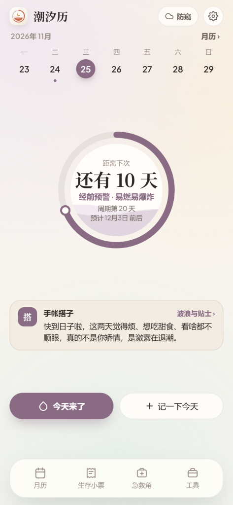
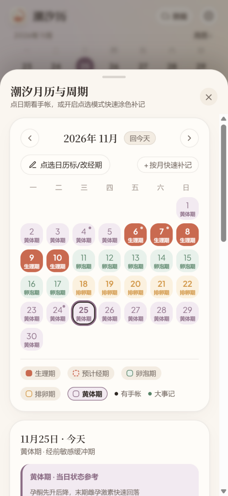
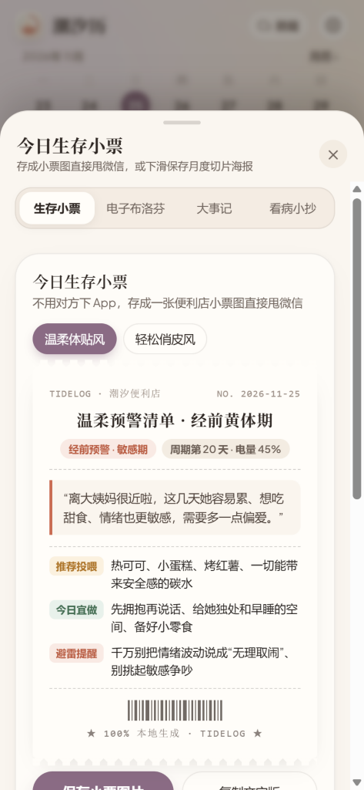
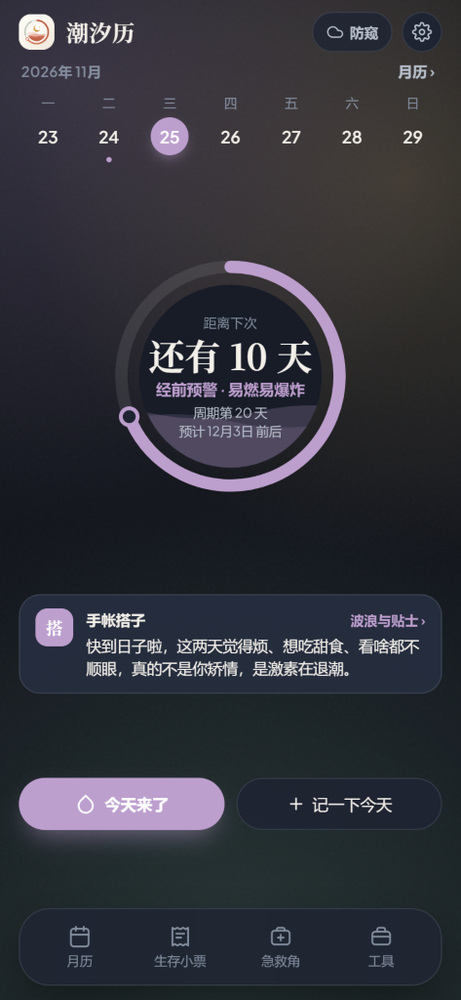
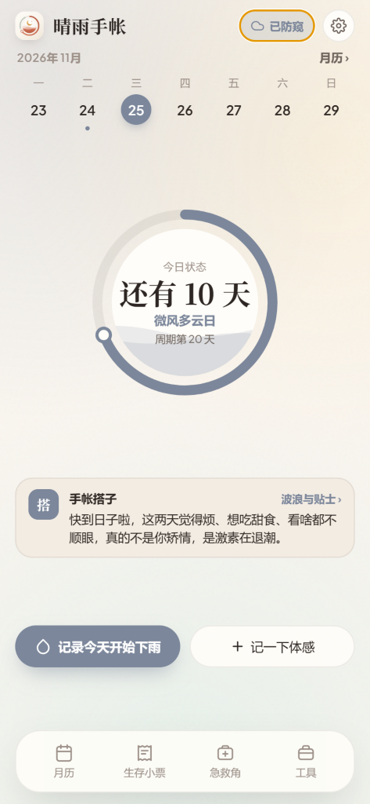
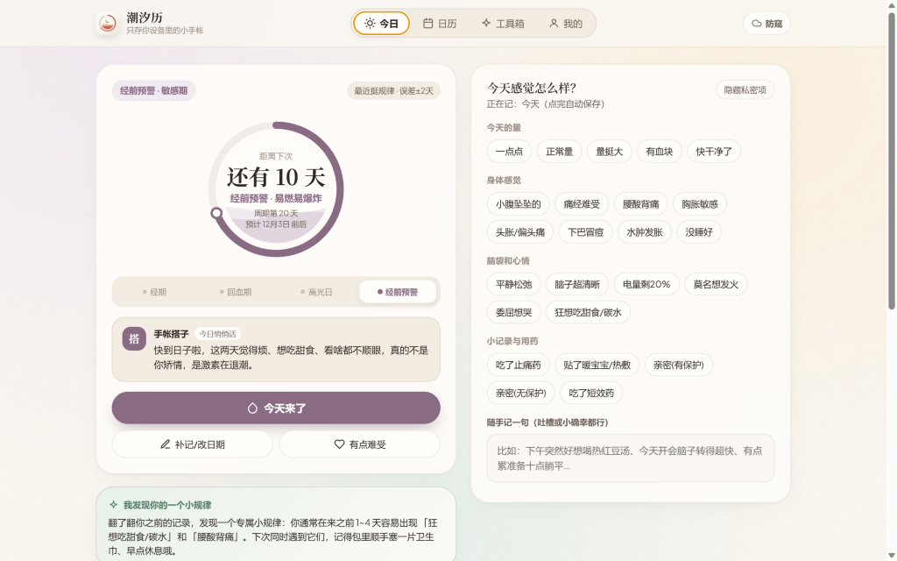
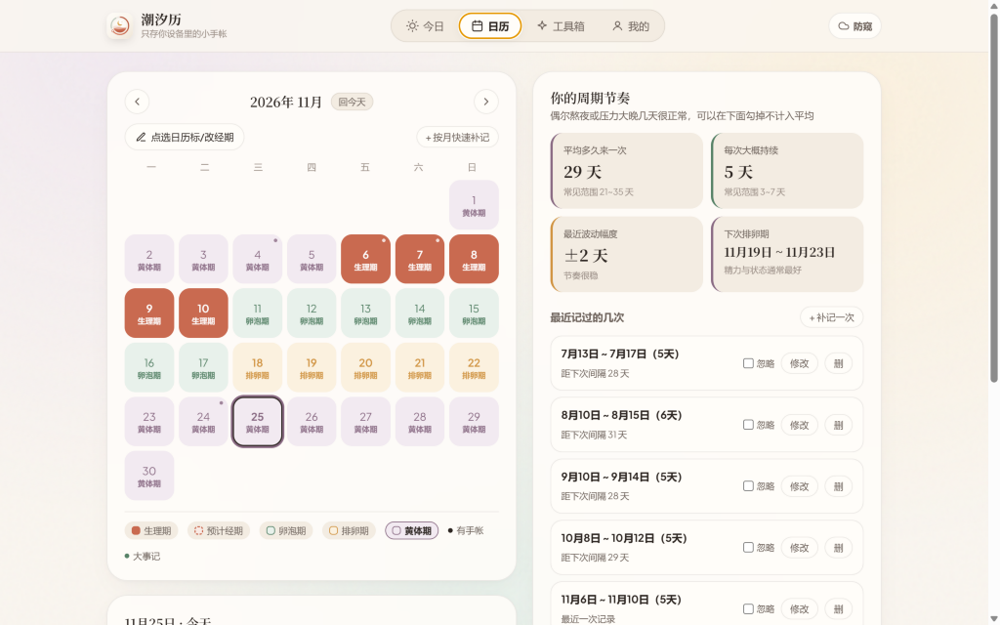
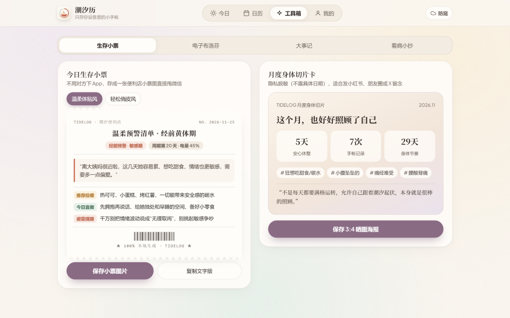

<p align="center">
  
</p>

<h1 align="center">TideLog — Local-First Gentle Cycle Journal</h1>

<p align="center">
  A zero-dependency, ad-free, <strong>100% Local-First</strong> mobile-first period and body journal (Vanilla HTML5 / CSS3 / JavaScript — double-click and use).
</p>

<p align="center">
  
  
  
</p>

<p align="center">
  <a href="README.md">中文</a> | <strong>English</strong>
</p>

---

## Live Screenshots

### Mobile-First Interface

| Home Tide Canvas | Color-Coded Calendar | Survival Receipt | Midnight Dark Theme | Stealth Weather Mode |
| :---: | :---: | :---: | :---: | :---: |
|  |  |  |  |  |

### Desktop Adaptive Two-Column Layout

<p align="center">
  
</p>

| Calendar & Cycle Rhythm Stats | Survival Receipt & Monthly Slice Poster |
| :---: | :---: |
|  |  |

---

## Key Features

Say goodbye to harsh neon-pink period apps, cold clinical jargon, and pop-up ads. **TideLog** is a calm, warm, privacy-first body journal built to feel grounded and human:

- **Mobile-First Single-Screen Canvas & 3 Curated Themes**
  - Designed around a breathing single-screen mobile canvas with bottom-sheet overlays, fine-line SVG icons, subtle paper grain, and an animated tidal progress ring.
  - Adapts automatically to a two-column desktop workspace with a 4-stage phase bar, interactive energy/sensitivity wave, and 3-second capsule logger.
  - Switch anytime between **Warm Paper**, **Oat Sage**, and **Midnight Dark**.
- **Empathetic Journal Companion**
  - Speaks plainly without anxiety or alarmism, offering reassuring messages even when a cycle runs late.
  - Reacts dynamically when you tap body or mood capsules.
- **Chronological Cycle History & 4-Phase Color-Coded Calendar**
  - Distinguishes **Period**, **Predicted Period**, **Follicular**, **Ovulation**, and **Luteal** phases with soft color tiles and interactive legend references explaining hormones, body signals, and self-care notes.
  - **Paint-to-Mark Calendar**: Toggle paint mode to tap past dates directly—contiguous dates merge automatically, and unmarking a middle day splits cleanly.
  - **Quick Retroactive Logging**: Chronological history list with one-tap duration presets (3–7 days), range previews, anomaly exclusion, and consecutive back-logging.
- **Interactive Energy Wave & Local Pattern Discovery**
  - Scrub or tap across the cycle wave to preview daily energy and sensitivity trends.
  - Automatically surfaces recurring pre-period signals strictly on-device.
- **Zero-Dependency Canvas Image Export**
  - **Daily Survival Receipt**: Retro serrated convenience-store thermal receipt in gentle or witty tones, exportable as high-res PNG to share with a partner or friend.
  - **Monthly Body Slice Card**: Automatically strips exact dates and intimate tags to export a clean 3:4 shareable poster.
  - **Gynecology Doctor's Cheat Sheet**: High-contrast clinical cycle summary with selectable questions for your doctor, ready to show, copy as text, or export as PNG.
- **Emergency Relief Corner & Multi-Event Planner**
  - Includes a guided 4-7-8 breathing orb, a vent-to-the-sea text shredder, and practical cramp-relief tips.
  - Save multiple upcoming trips, exams, or events to see phase collision forecasts on the calendar with persistent packing checklists.
- **Stealth Weather Journal & 100% Local Privacy Vault**
  - One tap switches the entire app into a plain weather and energy journal, hiding sensitive physiological terms in public spaces.
  - Zero backend servers—supports full `.json` backup export/restore and one-click local wipe.

---

## Quick Start & Deployment

Zero external dependencies—no install or build step required:

1. **Direct Open**: Double-click [`index.html`](index.html) in any modern browser.
2. **Local Preview**:
   ```powershell
   python -m http.server 8080
   ```
   Visit `http://127.0.0.1:8080` (on mobile over the same Wi-Fi, use "Add to Home Screen" to install as a PWA).
3. **GitHub Pages**:
   - In repository `Settings -> Pages`, set Source to **Deploy from a branch**, pick `main` (or `dev`) with `/ (root)`, and save.
   - Live URL: `https://wanqiuesw.github.io/tidelog-period-tracker/`.

## Directory Structure

```text
tidelog-period-tracker/
├── index.html             # Mobile-first UI (single-screen canvas, bottom sheets, desktop layout & modals)
├── styles.css             # 3 themes, stealth palette, thermal receipt styling & responsive grid
├── app.js                 # Cycle algorithm, companion engine, calendar phase guide, breathing orb & Canvas PNG export
├── manifest.json          # PWA standalone installation manifest
├── .nojekyll              # Serves static files directly on GitHub Pages without Jekyll processing
├── assets/
│   ├── icons/             # Brand SVG icon
│   └── screenshots/       # Mobile and desktop live demo screenshots
├── README.md              # Chinese documentation
└── README.en.md           # English documentation
```
