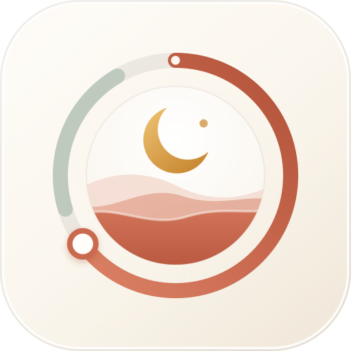

<p align="center">
  
</p>

<h1 align="center">TideLog — 潮汐历 · 女性身体四季与周期能量罗盘</h1>

<p align="center">
  一款零依赖、<strong>100% 本地隐私优先（Local-First）</strong>的去粉红化女性生理周期与荷尔蒙节律协同应用（原生 HTML5 / CSS3 / JavaScript）。
</p>

<p align="center">
  
  
  
  
  
</p>

<p align="center">
  <strong>中文</strong> | <a href="README.en.md">English</a>
</p>

---

## ✨ 项目简介

告别传统经期 App 刻板的「死亡芭比粉」、弹窗广告、备孕推销与云端隐私泄露焦虑！**潮汐历（TideLog）** 采用温润克制的**赤陶、鼠尾草绿与暖米白**杂志级美学，将女性 28~35 天的荷尔蒙周期翻译为自然的 **「身体四季（Cycle Syncing）」**——冬季休养（月经期）、春季萌发（卵泡期）、夏季盛放（排卵黄金期）与秋季内省（黄体期）。

无论是 **3 秒胶囊极速打卡**、办公室防窥屏的 **「🌙 月相暗语模式」**、看病不紧张忘词的 **「🩺 妇科门诊就医小抄」**，还是直接发给另一半的 **「💌 伴侣行动指南卡」**，所有数据均 100% 存储在浏览器本地 `localStorage`，零服务器上传，开箱即用。

## 🎯 核心亮点与特色

- **🧭 身体四季能量罗盘 & 荷尔蒙双曲线**：
  - **四季节律映射（Cycle Syncing）**：实时计算当前处于周期第几天（`Day X`），并以 SVG 呼吸圆环与雌激素/孕酮双曲线直观呈现身体当前所处的能量位置。
  - **三维生活与反焦虑指南**：根据当日雌激素与孕酮水平，自动生成今日 **「💼 工作与专注」「🏃‍♀️ 运动与饮食」「🫂 荷尔蒙情绪免责抱抱卡」**，用科学解释情绪波动，告别自责。
  - **弹性预测区间**：拒绝制造焦虑的“绝对单日倒计时”，基于历史有效周期波动范围动态计算下次来潮的**弹性预测窗口与置信度**。
- **🌙 首创「月相暗语模式（Camo Mode）」防窥屏**：
  - 在地铁、办公室或共享屏幕时一键开启，全站瞬间切换为极客天文台风格（**「观星台 StarLog」**），所有敏感生理词汇自动替换为月相与潮汐暗语（如 `月经期 → 朔月潮汐`、`痛经 → 强能量波动`、`亲密记录 → 双星交汇`），彻底告别窥屏社死。
- **🌿 3 秒身体胶囊打卡 & 私密标签隐身**：
  - 内置 **「经量与性状」「身体感受」「荷尔蒙情绪与精力」「私密与用药打卡」** 4 大类 24 枚高频胶囊标签，点按即存；支持一键隐藏私密与用药分类，兼顾便捷与体面。
- **🩺 妇科门诊就医一键小抄（Doctor's Card）**：
  - 专为妇科挂号问诊打造！自动提炼医生最关心的 **末次月经首日（LMP）、既往周期范围（最短~最长）、平均行经天数、近 6 次周期流水账及高频伴随症状**，以高对比度白底大字卡片呈现，支持递给医生看或一键复制纯文本病历摘要。
- **💌 伴侣关怀卡片 & ✈️ 重要日程撞期测算器**：
  - **伴侣/闺蜜今日行动指南卡**：无需对方下载任何 App，支持切换 **「🔬 温和科学风」「😼 傲娇幽默风」「⚡ 极简指令风」** 三种语气，把复杂的激素状态翻译成对方听得懂的 `✅ 今日宜做` 与 `❌ 今日大忌`，一键复制发微信。
  - **重要日程撞期测算器**：输入未来的海岛度假、大考、婚礼或比赛日期，立即推演当天所处的身体季节、撞期风险等级，并生成专属随身物资准备清单。
- **🛡️ 100% 本地隐私保险箱 & 异常周期过滤**：
  - **异常周期一键排除**：因偶发熬夜、长途旅行或高压导致的单次周期推迟，可在历史列表中勾选「排除异常」，避免污染均值预测算法。
  - **JSON 备份导出/恢复 & 一键焚毁**：支持将完整数据导出为本地 `.json` 备份文件随时跨设备迁移，并提供不可逆的 **「🔥 一键彻底焚毁本地痕迹」** 紧急按钮。

## 🚀 快速开始

本项目**零第三方依赖**，无需 `npm install` 或任何打包构建步骤：

### 1. 启动应用

- **方式 A（直接打开）**：直接双击打开项目根目录下的 [`index.html`](index.html)。
- **方式 B（本地 HTTP 服务）**：
  ```powershell
  python -m http.server 8080
  ```
  浏览器访问 [http://127.0.0.1:8080](http://127.0.0.1:8080)。
- **方式 C（GitHub Pages 在线访问）**：
  在 GitHub 仓库的 `Settings -> Pages` 中将部署分支设为 `main`，即可通过手机或电脑浏览器随时访问并添加到手机主屏幕（内置 PWA `manifest.json`）。

### 2. 操作速查

| 功能模块 | 操作说明 |
| --- | --- |
| **一键记录来潮/结束** | 在首页罗盘下方点击 **「🩸 今日大姨妈来了 / 经期今日结束」**，或点击 **「✍️ 补录/修改周期」** 录入历史起止日期 |
| **切换月相暗语防窥** | 点击右上角 **「🌙 月相暗语模式」** 开关，全站敏感生理词汇立即切换为天文潮汐隐喻词 |
| **记录任意日期症状** | 在「📅 四季日历与规律」中点击任意日期，即可在首页胶囊面板为该日补记症状胶囊与身体笔记 |
| **排除偶发异常周期** | 在「📅 四季日历与规律」右侧历史列表中勾选 **「排除异常」**，该次偶发波动将不再影响后续预测均值 |
| **门诊看病一键出示** | 切换至 **「🩺 妇科就医小抄」**，直接将大字摘要卡递给医生，或点击「📋 复制纯文本病历摘要」 |

## 🗂️ 目录结构

```text
tidelog-period-tracker/
├── assets/icons/      # 潮汐历品牌 SVG 图标资源
├── index.html         # 应用主界面（顶部暗语栏、5 大核心功能 Tab 面板与补录弹窗）
├── styles.css         # 全局样式表（去粉红化四季暖调 CSS 变量、响应式网格与暗语主题）
├── app.js             # 核心预测算法引擎、身体四季映射、胶囊状态机、本地存储与自检断言
├── manifest.json      # PWA 渐进式网页应用清单（支持添加到手机主屏幕独立运行）
├── README.md          # 中文项目文档
└── README.en.md       # 英文项目文档
```

## 🧪 核心算法自检断言

应用在 [`app.js`](app.js) 启动时内置了 `runSelfChecks()` 零依赖自检断言，自动验证周期均值边界、弹性预测窗口顺序以及身体四季（冬季行经期 / 夏季排卵期）映射准确性，确保预测模型稳定可靠。
